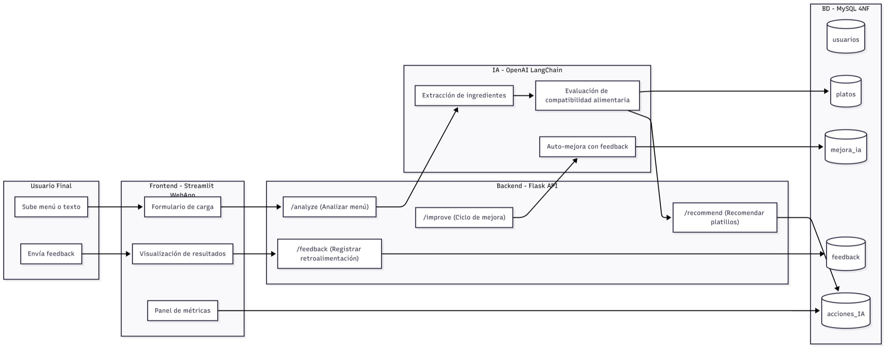
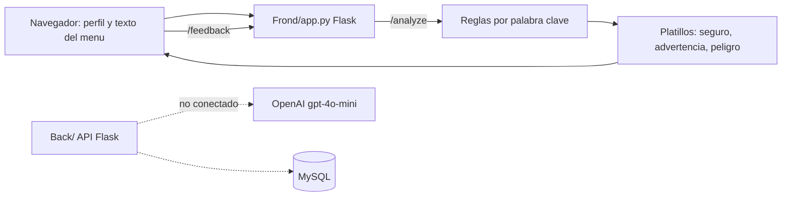
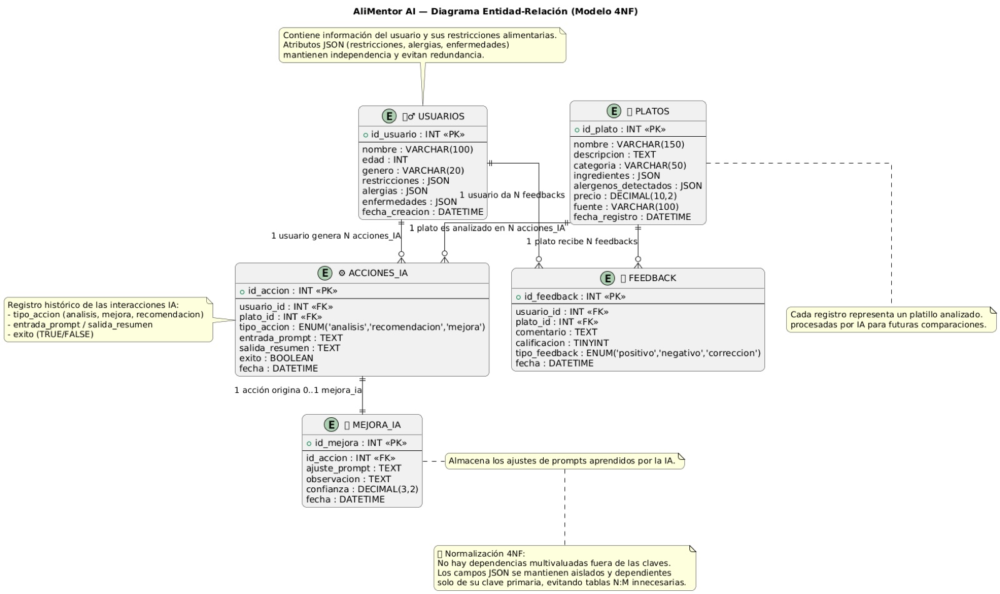

<div align="center">

# 🍽️ AliMentor AI

### Revisa un menú contra tus alergias y restricciones antes de pedir.

Prototipo de analizador de menús: cruza los platillos con el perfil alimentario de la persona y marca cada uno como seguro, con advertencia o peligroso.

[](#-estado-del-proyecto)
[](#-estado-del-proyecto)


<br/>


<br/><sub>Diagrama de arquitectura del diseño original (de la documentación del equipo).</sub>

</div>

> [!NOTE]
> **Prototipo con backend incompleto y sin deploy.** El código está dentro de `AliMentor_AI.rar` y la documentación en `Documentacion.zip`. El servidor que sirve la interfaz (`Frond/app.py`) **simula** el análisis con reglas por palabras clave y datos en memoria; el backend con OpenAI y MySQL (`Back/`) está escrito pero no quedó conectado ni desplegado. No hay demo en línea ni capturas de la app.

---

## 🎯 El problema

Para quien tiene alergias (mariscos, nuez, soya), intolerancias (lactosa, gluten) o una dieta específica, leer un menú es adivinar: los ingredientes casi nunca vienen completos y preguntar plato por plato es lento.

## 💡 La propuesta

1. La persona arma su **perfil**: restricciones, alergias y enfermedades relacionadas con la comida.
2. Pega el **texto del menú**.
3. El sistema extrae los platillos y sus ingredientes probables y los clasifica: **seguro**, **advertencia** o **peligro**, con una explicación y una alternativa.
4. La persona califica el resultado; el diseño contempla usar ese feedback para ajustar el prompt en una segunda corrida ("Run 1 vs Run 2").

```
 Menú:      "Pizza, ensalada con pollo, pasta"
 Resultado: Pizza     → advertencia: contiene gluten y lácteos
            Ensalada  → seguro: revisar el aderezo por alérgenos ocultos
            Pasta     → advertencia: contiene gluten
```

## 🔎 Qué hay en el código

| Parte | Qué hace hoy |
|:--|:--|
| `Frond/` (Flask + JavaScript) | Interfaz de una página con login simple, perfil, carga de menú, resultados, feedback y panel de métricas. Su `app.py` responde `/analyze`, `/recommend`, `/feedback`, `/metrics` y CRUD de usuarios y platos con **datos simulados en memoria** |
| `Back/` (Flask + SQLAlchemy) | API con blueprints (`analyze`, `recommend`, `feedback`, `improve`, `metrics`, `upload`), modelos de base de datos y un `AIService` que llama a OpenAI (`gpt-4o-mini`). Requiere MySQL y una API key; no quedó integrado con la interfaz |
| `Documentacion.zip` | PDF de documentación general y diagramas UML: casos de uso, clases, secuencia, actividades, flujo, arquitectura, E-R y relacional |

## 🧠 Cómo funciona (código actual)



<details>
<summary><b>Modelo de datos del diseño (4FN)</b></summary>



Tablas: `usuarios`, `platos`, `acciones_ia`, `feedback` y `mejora_ia`. Las restricciones, alergias e ingredientes se guardan como JSON.

</details>

## 🛠️ Stack

| Capa | Tecnología |
|:--|:--|
| Interfaz | HTML, CSS y JavaScript sin framework, servida con Flask |
| Backend | Python · Flask 2.3 · SQLAlchemy 2 · PyMySQL · flask-cors · flask-swagger-ui |
| IA (backend) | SDK de OpenAI (`gpt-4o-mini`) · LangChain en `requirements.txt` |
| Pruebas | pytest (`Back/tests/`) |

## 🚀 Correrlo en tu compu

Primero descomprime `AliMentor_AI.rar` (por ejemplo con 7-Zip o `unar`).

```bash
# Interfaz con datos simulados (lo que funciona hoy)
cd AliMentor_AI/Frond
pip install flask flask-cors
python app.py            # http://127.0.0.1:5000
```

```bash
# Backend con OpenAI y MySQL (incompleto)
cd AliMentor_AI/Back
python -m venv venv && source venv/bin/activate
pip install -r requirements.txt
cp env_example.txt .env  # llena DB_* y OPENAI_API_KEY
python app.py
python -m pytest tests/
```

## 🗺️ Estado del proyecto

| | |
|:--|:--|
| Interfaz y flujo de demo | Hecho, con datos simulados |
| Backend con IA real y MySQL | Escrito, sin integrar |
| Deploy | No hay |
| Ciclo de auto-mejora con feedback | Diseñado (diagramas y modelos), no probado de punta a punta |

## 👥 Equipo

Proyecto en equipo; el código lo subieron [BereniceCb](https://github.com/BereniceCb) y [ramirezcedric65-alt](https://github.com/ramirezcedric65-alt). Publicado en la cuenta de **ALFA** ([ALFA117](https://github.com/ALFA117)).

---

<div align="center">

**AliMentor AI** · prototipo de análisis alimentario

</div>
